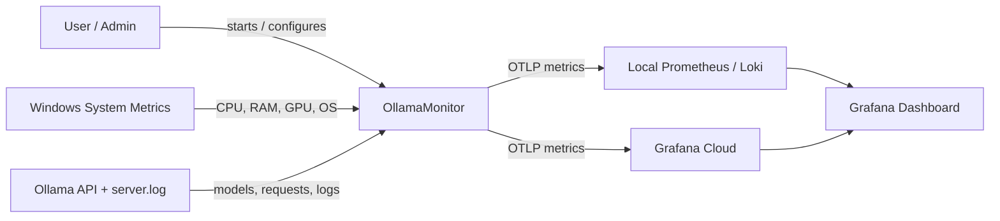

# OllamaMonitor

Monitor your local Windows machine and your Ollama instance, then send telemetry to Grafana Cloud or a local Prometheus/Loki stack.

## Features
- Collect CPU, RAM, GPU, and OS information.
- Query Ollama `/api/ps` for loaded models and VRAM usage.
- Parse Ollama log lines to track requests, tokens, prompt size, and failures.
- Export metrics via OTLP to Grafana Cloud or a local Prometheus endpoint.
- Forward Ollama log entries to Loki for local log analysis.

## System Context



## Prerequisites
- Windows machine with Ollama installed and running
- Docker Desktop if you want to run Prometheus/Loki locally
- Optional: Grafana Cloud account for remote metric export

## Quick Start

Run it locally:

```powershell
dotnet run --project src/OllamaMonitor/OllamaMonitor.csproj
```

Start the local monitoring stack:

```powershell
cd docker
docker compose up -d
```

## Configuration

Edit:

```text
src/OllamaMonitor/appsettings.json
```

Key values:

- `Monitor:OllamaUrl`
- `Monitor:LogPath`
- `LocalPrometheus:OtlpEndpoint`
- `Loki:Url`
- `GrafanaCloud:OtlpEndpoint`
- `GrafanaCloud:InstanceId`

For Grafana Cloud, store the token as a user secret or environment variable instead of hardcoding it in JSON:

```powershell
dotnet user-secrets set "GrafanaCloud:Token" "glc_..."
```

## Local Docker Stack

The Docker setup includes:
- Prometheus
- Grafana
- Loki

Dashboard file:

```text
docs/grafana-dashboard.json
```

## Notes
- The app collects system metrics and Ollama runtime data without sending prompt content itself.
- Log data is forwarded to Loki only if enabled.
- If no Grafana Cloud or local Prometheus endpoint is configured, metrics are printed to the console for testing.
